## About

Computer Science student at **UNIFAL-MG**, building a foundation in **data, machine learning and cloud**. I'm especially curious about how these can be applied to **healthcare and the pharmaceutical field**.

I'm also **Director of Marketing at the AWS Cloud Club**, helping students get started with cloud technologies.

> I'm not trying to know everything yet. I'm building the foundation to create meaningful things later.

## Stack

  

`NumPy` `Pandas` `Matplotlib` `Scikit-learn` · `S3` `EC2` `IAM`

## Projects

**🧬 Predictive Bioactivity & Quality Control Pipeline** · `Python` `Machine Learning` `Data Science`  
Machine Learning applied to bioactivity prediction and quality control of natural extracts, aimed at pharmaceutical use. *Research / development.*

**☁️ AWS Cloud Learning** · `AWS` `S3` `EC2`  
Hands-on practice with object storage, permissions and static website hosting.

**🎮 [RetroGames](https://github.com/aurelio-junior/RetroGames)** · `C#` `ASP.NET Core` `React` `MySQL`  
Web system to catalog and manage used retro games.

`LEARN → BUILD → EXPERIMENT → SHARE`

